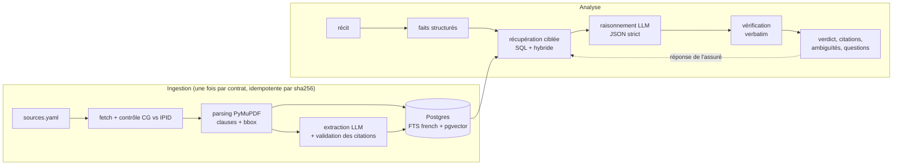

# Sinistre & Conditions Générales

**Le contrat d'assurance habitation couvre-t-il ce sinistre ?** Réponse argumentée à partir des conditions générales publiques, avec chaque étape du raisonnement adossée à une clause citée **mot pour mot**, les ambiguïtés signalées et les questions à poser à l'assuré.

**Démo : https://sinistre.51-170-130-195.sslip.io**

> Démonstration technique : ni avis juridique ni décision d'indemnisation. Documents publics uniquement, liens vers les sources.

## Le problème

Un gestionnaire reçoit une déclaration : « mon vélo a été volé dans le local commun ». Il doit retrouver la garantie, ses conditions, les exclusions et les définitions dans 60 à 120 pages, puis décider ou demander ce qui manque. Le cas difficile n'est pas le verdict : c'est de savoir **quand on ne peut pas encore conclure**.

## Ce que fait le système

Quatre verdicts : `COUVERT`, `NON COUVERT`, `AMBIGU`, `INFORMATION MANQUANTE`.

- un raisonnement en étapes (garantie → conditions → exclusions → définitions → plafond → conclusion) ;
- une citation vérifiée par étape, cliquable : le PDF s'ouvre à la page avec les lignes de la clause surlignées ;
- les ambiguïtés (notion non définie, clauses contradictoires, conditions particulières inconnues) ;
- les questions à l'assuré (« le local était-il fermé à clé ? ») : la réponse relance l'analyse sans tout recalculer ;
- le mode **Tous les contrats** : le même sinistre sur les 6 contrats, côte à côte.

## Pourquoi ce n'est pas un « chatbot sur un PDF »

1. **Chaque contrat devient une base structurée** : garanties (sur un référentiel commun de 15 catégories), exclusions, définitions, conditions, plafonds. Chaque ligne pointe vers ses clauses et porte une citation **vérifiée** contre le texte ; sinon elle est rejetée (et journalisée).
2. **L'analyse est une requête ciblée** : SQL sur la catégorie du sinistre (garanties, conditions, exclusions spécifiques et générales, définitions des termes en jeu), puis recherche hybride (plein texte français + vecteurs BGE-M3, fusion RRF) en filet de sécurité.
3. **Pas de citation, pas d'affirmation** : chaque citation du raisonnement est revérifiée ; en cas d'échec, un nouvel essai avec l'erreur, puis retrait de l'étape et rétrogradation du verdict. `COUVERT` exige une garantie citée **et** la vérification des exclusions.
4. **Les faits inconnus restent inconnus** : la qualification du récit met `null` plutôt que de supposer, ce qui déclenche des questions au lieu d'un verdict inventé.

## Résultats

Voir la page [`/evaluation`](https://sinistre.51-170-130-195.sslip.io/evaluation) et [`eval/REPORT.md`](eval/REPORT.md) : 25 cas synthétiques (les deux cas de l'énoncé et leurs variantes, vol, dégâts des eaux, incendie, bris de glace, RC, tempête, cas pièges). Les verdicts attendus sont **proposés** et en cours de validation manuelle ; les échecs sont affichés avec l'écart constaté.

## Architecture



| Couche | Choix |
|---|---|
| API | FastAPI, Pydantic v2 (toutes les sorties LLM sont des schémas validés) |
| Base | PostgreSQL 17 + pgvector, recherche plein texte `french` |
| Embeddings | BGE-M3 servi localement (aucun appel externe) |
| LLM | Gemini (structured output) derrière une interface `LLMClient` |
| Interface | Jinja2 + htmx + Tailwind + PDF.js, sans build JS |
| Déploiement | Docker Compose sur Oracle Cloud Always Free (ARM), Caddy (HTTPS), CI GitHub Actions |

Décisions et écarts au plan initial : [`docs/DECISIONS.md`](docs/DECISIONS.md).

## Passer à des centaines de contrats

- Ingestion idempotente (sha256) ; coût LLM payé une seule fois par contrat.
- Même schéma d'extraction et même référentiel de catégories pour tous : les contrats deviennent comparables et requêtables en SQL (« quels contrats excluent le vol dans les parties communes ? »).
- Coût et latence d'une analyse indépendants de la taille du corpus : la récupération ne lit que les clauses du contrat et de la catégorie concernés.
- Versionnage par date d'effet ; file de validation humaine pour les extractions rejetées ; évaluation par contrat pour détecter les régressions.

## Limites assumées

- Seules les **conditions générales** sont lues ; les conditions particulières, qui priment, ne sont pas connues : le système le signale et n'affirme jamais une couverture définitive.
- Montants et franchises dépendent souvent des conditions particulières.
- Les contrats FR et BE relèvent d'autres cadres légaux : ils montrent la généricité du pipeline.
- Le parsing est générique (polices, gras, numérotation) : les mises en page en colonnes et les tableaux donnent des fils d'Ariane imparfaits.
- Ni jurisprudence ni pratiques de gestion.

## Lancer en local

```bash
cp .env.example .env              # GEMINI_API_KEY
make up                           # Postgres + serveur d'embeddings
make fetch                        # télécharge les PDF -> data/raw (jamais versionnés)
make ingest                       # parsing + embeddings + extraction structurée
make stats
make dev                          # http://localhost:8000
make eval
```

Déploiement : [`docs/DEPLOIEMENT.md`](docs/DEPLOIEMENT.md).

## Sources des documents

| Contrat | Pays | Source |
|---|---|---|
| AXA Assurances Luxembourg – OptiHome (W03_24) | LU | [axa.lu](https://axa.lu/sites/axa/files/2025-10/CA_OptiHome_W03_24_FR_0.pdf) |
| Baloise – Habitation Select (06/2026) | BE | [baloise.be](https://www.baloise.be/dam/jcr:b8f29d19-63c3-4cb0-b5c1-d75fb14f9954/B2053.BRA.06.26-CG-Habitation-Select.pdf) |
| Luko – Habitation (HMIN 2504) | FR | [luko.eu](https://www.fr.luko.eu/dam/documents/t-c/Conditions_generales_HMIN_2504.pdf) |
| AssurPeople – Ma Maison | FR | [assurpeople.com](https://assurpeople.com/sites/default/files/conditions-generales/455mamaison-dipa-cg1.pdf) |
| CCF – Multirisque Habitation | FR | [ccf.fr](https://ccf.fr/content/dam/documentation-commerciale/fiches/cg-notice-ccf-mrh.pdf) |
| Altima – Multirisque Habitation | FR | [altima-assurances.fr](https://www.altima-assurances.fr/sites/default/files/produits/habitation/cg_mrh.pdf) |
